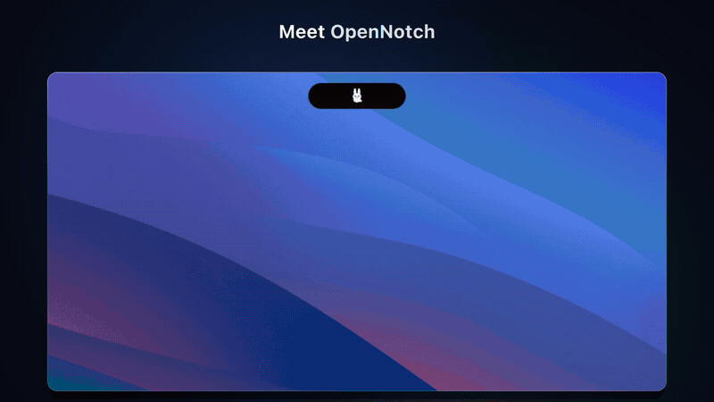
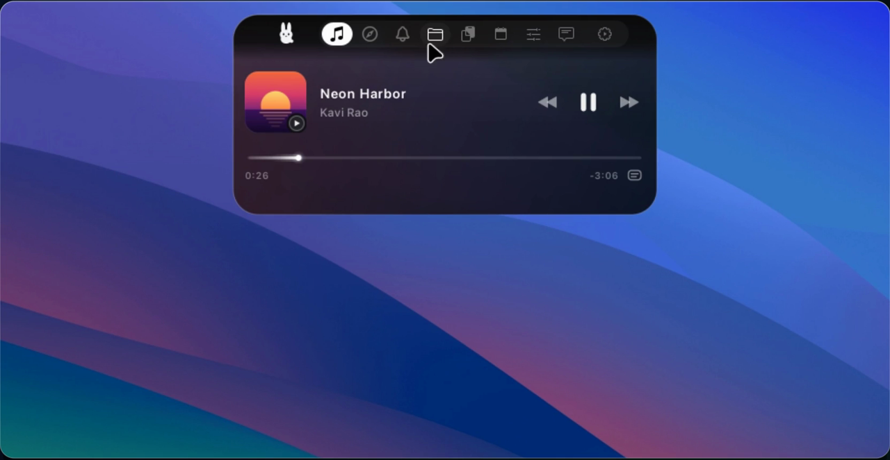
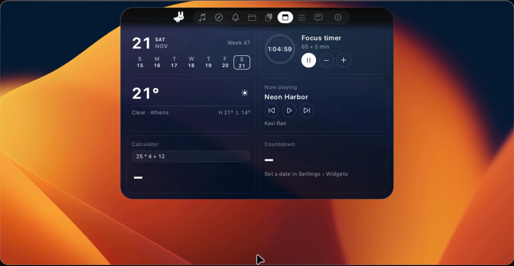
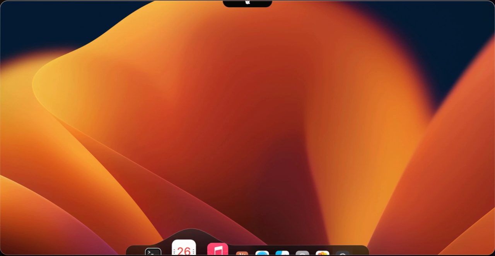

<div align="center">

# OpenNotch

**Liquid glass Dynamic Island, Now Playing bar, and matching taskbar for Linux (X11) and Windows 10/11.**

100% free, open source, and local. No telemetry, no accounts, no cloud sync.

[](https://github.com/nocturnehq/opennotch/actions/workflows/ci.yml)
[](https://github.com/nocturnehq/opennotch/releases)
[](LICENSE)

<br/>



</div>

---

## Screenshots

| Now Playing & Liquid Glass | Overview Widgets & Focus Timer | Liquid Glass Taskbar Wave |
| :---: | :---: | :---: |
|  |  |  |

---

## Features

- **Real Liquid Glass**: Translucent blurred backdrop that adapts to your wallpaper and album art, with floating Dynamic Island or attached notch shapes.
- **Now Playing Music Bar**: Interactive **Wave**, **Comet**, and **Glass** scrub bars, crisp vector transport controls, synced lyrics (LRCLIB), and live pill visualizers (**Bars**, **Pixels**, **Dots**).
- **Live Companion Pet**: Interactive bunny, cat, or dog that hangs out right in your notch.
- **Overview Widgets**: Calendar, Focus timer ring, Weather, live CPU/GPU/RAM/Network stats, Battery, Storage, Calculator, Countdown, To do list, Reminders, and World Clock.
- **Instant System Controls**: Volume (PipeWire / PulseAudio on Linux, CoreAudio on Windows), screen brightness (KDE PowerDevil, Cinnamon, `brightnessctl`, Windows WMI), and quick toggles.
- **Custom Liquid Glass Taskbar** (Linux + Plank): Matching floating glass dock with icon magnification, tray & clock, window previews, and `Super + 1..9` shortcuts.
- **Built in Web Tab, Clipboard History & File Shelf**: Quick access browser drawer (YouTube Music, Spotify, SoundCloud, YouTube, ChatGPT, Claude), local clipboard history, drag and drop shelf, notifications, screenshots, and screen recording.
- **Bilingual UI**: English and Greek (`en` / `el`).

---

## Download & Install

### Windows 10 & 11

1. Download **`OpenNotch-Windows.zip`** from [**Releases**](https://github.com/nocturnehq/opennotch/releases).
2. Unzip it anywhere and double click **`OpenNotch.exe`**.

<details>
<summary>Building from source on Windows (developers)</summary>

```powershell
cd windows
pip install -r requirements.txt
python -m opennotch_win        # run from source
python build_exe.py            # build standalone dist\OpenNotch.exe
```
</details>

---

### Linux (Ubuntu, Mint, Debian & Fedora)

```bash
git clone https://github.com/nocturnehq/opennotch.git
cd opennotch
./packaging/install-deps.sh
./install.sh
```

### Arch Linux (Manjaro, EndeavourOS, CachyOS)

Download the prebuilt `.pkg.tar.zst` from [**Releases**](https://github.com/nocturnehq/opennotch/releases), or build locally:

```bash
cd packaging/arch
makepkg -si
```

<details>
<summary>Run without installing / Uninstall</summary>

```bash
./bin/opennotch           # run directly from checkout
./uninstall.sh            # uninstall (add --purge to remove settings & history)
```
</details>

---

## CLI Notifications (Linux)

Send status toasts straight to the island from any terminal or build script:

```bash
opennotch say "Build finished" --icon ok --seconds 6
make && opennotch say "Build OK" --icon ok || opennotch say "Build failed" --icon fail
```

---

## Tests

```bash
python3 -m opennotch.selftest   # Linux test suite
python3 windows/selftest_win.py # Windows test suite
```

## License

[MIT](LICENSE)
